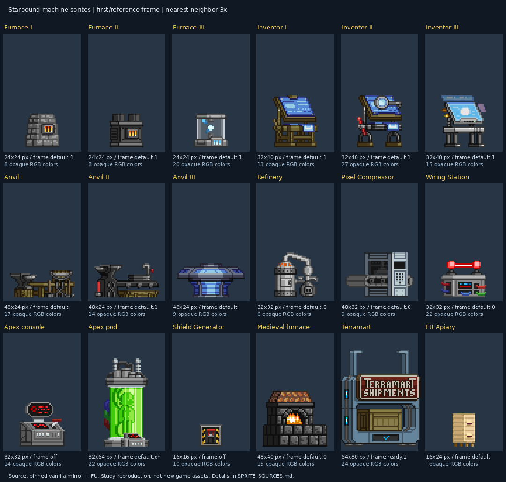

# Fontes e medidas do estudo de sprites de máquinas

Estudo realizado em 2026-10-27. Referência local do mod: `a7e44c6` (`0.2.42-dev`).

O espelho vanilla é uma fonte de assets, não um manual oficial de direção de arte. O código OpenStarbound sustenta os contratos técnicos. As conclusões estéticas são observações desta amostra.

A versão comercial do executável correspondente ao espelho não foi identificada
neste estudo. As revisões fixas abaixo delimitam a evidência e permitem repetir
a consulta mesmo se os repositórios mudarem.

| Fonte | Revisão fixa | Uso |
| --- | --- | --- |
| [Vanilla: FerreiraJGB/Starbound](https://github.com/FerreiraJGB/Starbound/tree/3b370d25c27923155badb38c414a664e1ee2abfc) | `3b370d25c27923155badb38c414a664e1ee2abfc` | 11 famílias de objetos; 17 frames representativos |
| [Frackin Universe](https://github.com/sayterdarkwynd/FrackinUniverse/tree/17868d86c9bb7bc00f92038fb78b48cebd1b41b8) | `17868d86c9bb7bc00f92038fb78b48cebd1b41b8` | Apiary, Bee Station e Bee Refuge |
| [OpenStarbound](https://github.com/OpenStarbound/OpenStarbound/tree/e604e078e89310f1212dd20f5cd01bd59d25300b) | `e604e078e89310f1212dd20f5cd01bd59d25300b` | Escala, orientação, ocupação e animação |

A prancha preserva a escala relativa (3× por vizinho mais próximo). As camadas PNG foram compostas sobre fundo neutro, sem simular iluminação do jogo. Os assets permanecem atribuídos a seus autores; esta prancha é uma referência de estudo fora do pacote do mod.

## Amostra medida

| Referência | Frame nativo | Cores RGB opacas | Pixels com alfa parcial | PNG principal / frames |
| --- | --- | --- | --- | --- |
| Furnace I | 24×24 | 8 | 0 | [PNG](https://github.com/FerreiraJGB/Starbound/blob/3b370d25c27923155badb38c414a664e1ee2abfc/assets/packed/objects/crafting/upgradeablecraftingobjects/craftingfurnace/craftingfurnace.png) · [frames](https://github.com/FerreiraJGB/Starbound/blob/3b370d25c27923155badb38c414a664e1ee2abfc/assets/packed/objects/crafting/upgradeablecraftingobjects/craftingfurnace/default.frames) |
| Furnace II | 24×24 | 8 | 0 | [PNG](https://github.com/FerreiraJGB/Starbound/blob/3b370d25c27923155badb38c414a664e1ee2abfc/assets/packed/objects/crafting/upgradeablecraftingobjects/craftingfurnace/craftingfurnace2.png) · [frames](https://github.com/FerreiraJGB/Starbound/blob/3b370d25c27923155badb38c414a664e1ee2abfc/assets/packed/objects/crafting/upgradeablecraftingobjects/craftingfurnace/default.frames) |
| Furnace III | 24×24 | 20 | 214 | [PNG](https://github.com/FerreiraJGB/Starbound/blob/3b370d25c27923155badb38c414a664e1ee2abfc/assets/packed/objects/crafting/upgradeablecraftingobjects/craftingfurnace/craftingfurnace3.png) · [frames](https://github.com/FerreiraJGB/Starbound/blob/3b370d25c27923155badb38c414a664e1ee2abfc/assets/packed/objects/crafting/upgradeablecraftingobjects/craftingfurnace/craftingfurnace3.frames) |
| Inventor I | 32×40 | 13 | 0 | [PNG](https://github.com/FerreiraJGB/Starbound/blob/3b370d25c27923155badb38c414a664e1ee2abfc/assets/packed/objects/crafting/upgradeablecraftingobjects/inventorstable/inventorstable.png) · [frames](https://github.com/FerreiraJGB/Starbound/blob/3b370d25c27923155badb38c414a664e1ee2abfc/assets/packed/objects/crafting/upgradeablecraftingobjects/inventorstable/default.frames) |
| Inventor II | 32×40 | 27 | 0 | [PNG](https://github.com/FerreiraJGB/Starbound/blob/3b370d25c27923155badb38c414a664e1ee2abfc/assets/packed/objects/crafting/upgradeablecraftingobjects/inventorstable/inventorstable2.png) · [frames](https://github.com/FerreiraJGB/Starbound/blob/3b370d25c27923155badb38c414a664e1ee2abfc/assets/packed/objects/crafting/upgradeablecraftingobjects/inventorstable/default.frames) |
| Inventor III | 32×40 | 15 | 113 | [PNG](https://github.com/FerreiraJGB/Starbound/blob/3b370d25c27923155badb38c414a664e1ee2abfc/assets/packed/objects/crafting/upgradeablecraftingobjects/inventorstable/inventorstable3.png) · [frames](https://github.com/FerreiraJGB/Starbound/blob/3b370d25c27923155badb38c414a664e1ee2abfc/assets/packed/objects/crafting/upgradeablecraftingobjects/inventorstable/inventorstable3.frames) |
| Anvil I | 48×24 | 17 | 0 | [PNG](https://github.com/FerreiraJGB/Starbound/blob/3b370d25c27923155badb38c414a664e1ee2abfc/assets/packed/objects/crafting/upgradeablecraftingobjects/craftinganvil/craftinganvil.png) · [frames](https://github.com/FerreiraJGB/Starbound/blob/3b370d25c27923155badb38c414a664e1ee2abfc/assets/packed/objects/crafting/upgradeablecraftingobjects/craftinganvil/default.frames) |
| Anvil II | 48×24 | 14 | 0 | [PNG](https://github.com/FerreiraJGB/Starbound/blob/3b370d25c27923155badb38c414a664e1ee2abfc/assets/packed/objects/crafting/upgradeablecraftingobjects/craftinganvil/craftinganvil2.png) · [frames](https://github.com/FerreiraJGB/Starbound/blob/3b370d25c27923155badb38c414a664e1ee2abfc/assets/packed/objects/crafting/upgradeablecraftingobjects/craftinganvil/craftinganvil2.frames) |
| Anvil III | 48×24 | 9 | 0 | [PNG](https://github.com/FerreiraJGB/Starbound/blob/3b370d25c27923155badb38c414a664e1ee2abfc/assets/packed/objects/crafting/upgradeablecraftingobjects/craftinganvil/craftinganvil3.png) · [frames](https://github.com/FerreiraJGB/Starbound/blob/3b370d25c27923155badb38c414a664e1ee2abfc/assets/packed/objects/crafting/upgradeablecraftingobjects/craftinganvil/craftinganvil3.frames) |
| Refinery | 32×32 | 6 | 0 | [PNG](https://github.com/FerreiraJGB/Starbound/blob/3b370d25c27923155badb38c414a664e1ee2abfc/assets/packed/objects/crafting/refinery/refinery.png) · [frames](https://github.com/FerreiraJGB/Starbound/blob/3b370d25c27923155badb38c414a664e1ee2abfc/assets/packed/objects/crafting/refinery/refinery.frames) |
| Pixel Compressor | 48×32 | 9 | 0 | [PNG](https://github.com/FerreiraJGB/Starbound/blob/3b370d25c27923155badb38c414a664e1ee2abfc/assets/packed/objects/crafting/pixelcompressor/pixelcompressor.png) · [frames](https://github.com/FerreiraJGB/Starbound/blob/3b370d25c27923155badb38c414a664e1ee2abfc/assets/packed/objects/crafting/pixelcompressor/pixelcompressor.frames) |
| Wiring Station | 32×32 | 22 | 0 | [PNG](https://github.com/FerreiraJGB/Starbound/blob/3b370d25c27923155badb38c414a664e1ee2abfc/assets/packed/objects/crafting/wiringstation/wiringstation.png) · [frames](https://github.com/FerreiraJGB/Starbound/blob/3b370d25c27923155badb38c414a664e1ee2abfc/assets/packed/objects/crafting/wiringstation/wiringstation.frames) |
| Apex console | 32×32 | 14 | 0 | [PNG](https://github.com/FerreiraJGB/Starbound/blob/3b370d25c27923155badb38c414a664e1ee2abfc/assets/packed/objects/apex/apexconsole1/apexconsole1.png) · [frames](https://github.com/FerreiraJGB/Starbound/blob/3b370d25c27923155badb38c414a664e1ee2abfc/assets/packed/objects/apex/apexconsole1/apexconsole1.frames) |
| Apex pod | 32×64 | 22 | 0 | [PNG](https://github.com/FerreiraJGB/Starbound/blob/3b370d25c27923155badb38c414a664e1ee2abfc/assets/packed/objects/apex/apexpod/apexpod.png) · [frames](https://github.com/FerreiraJGB/Starbound/blob/3b370d25c27923155badb38c414a664e1ee2abfc/assets/packed/objects/apex/apexpod/apexpod.frames) |
| Shield Generator | 16×16 | 10 | 0 | [PNG](https://github.com/FerreiraJGB/Starbound/blob/3b370d25c27923155badb38c414a664e1ee2abfc/assets/packed/objects/wired/shieldgenerator/shieldgenerator.png) · [frames](https://github.com/FerreiraJGB/Starbound/blob/3b370d25c27923155badb38c414a664e1ee2abfc/assets/packed/objects/wired/shieldgenerator/shieldgenerator.frames) |
| Medieval furnace | 48×40 | 15 | 0 | [PNG](https://github.com/FerreiraJGB/Starbound/blob/3b370d25c27923155badb38c414a664e1ee2abfc/assets/packed/objects/glitch/medievalfurnace/medievalfurnace.png) · [frames](https://github.com/FerreiraJGB/Starbound/blob/3b370d25c27923155badb38c414a664e1ee2abfc/assets/packed/objects/glitch/medievalfurnace/medievalfurnace.frames) |
| Terramart | 64×80 | 24 | 0 | [PNG](https://github.com/FerreiraJGB/Starbound/blob/3b370d25c27923155badb38c414a664e1ee2abfc/assets/packed/objects/generic/cropshipper/cropshipper.png) · [frames](https://github.com/FerreiraJGB/Starbound/blob/3b370d25c27923155badb38c414a664e1ee2abfc/assets/packed/objects/generic/cropshipper/default.frames) |
| FU Apiary | 16×24 | não contado | não contado | [PNG](https://github.com/sayterdarkwynd/FrackinUniverse/blob/17868d86c9bb7bc00f92038fb78b48cebd1b41b8/bees/objects/apiary/object.png) · [frames](https://github.com/sayterdarkwynd/FrackinUniverse/blob/17868d86c9bb7bc00f92038fb78b48cebd1b41b8/bees/objects/apiary/object.frames) |

A contagem usa somente pixels com alfa 255 na composição do frame registrado. Não inclui o restante da folha nem cores resultantes da iluminação do mundo. Furnace III e Inventor III usam alfa parcial em suas camadas; por isso seu número de cores opacas sozinho não descreve toda a aparência. Os 17 ícones de inventário vanilla correspondentes medem 16×16; isso é a amostra, não um tamanho obrigatório do engine.

O [manifesto JSON](reference/machine-sprite-sources.json) registra os arquivos consultados, URLs imutáveis, SHA-256, ordem de composição, caixa visível e cores mais frequentes. Arquivos adicionais dão contexto técnico; não foram todos incluídos na prancha.

## Referências complementares do FU e do projeto

- [Bee Station](https://github.com/sayterdarkwynd/FrackinUniverse/tree/17868d86c9bb7bc00f92038fb78b48cebd1b41b8/objects/bees/beestation): bancada 32×16 e ícone 16×16.
- [Bee Refuge](https://github.com/sayterdarkwynd/FrackinUniverse/tree/17868d86c9bb7bc00f92038fb78b48cebd1b41b8/objects/bees/beerefuge): placa como parte dominante, carcaça 106×126, camada emissiva separada.
- [Analyzer no projeto](../FUBeesGenetics/objects/bees/fubeesgenetics/geneticqueenfilter/geneticqueenfilter.object): canvas 40×32, origem `[0,0]`, ocupação explícita 5×4 e `dualImage`.
- [Auto Refugee no projeto](../FUBeesGenetics/objects/bees/fubeesgenetics/beeexchange/beeexchange.object) e [animação](../FUBeesGenetics/objects/bees/fubeesgenetics/beeexchange/beeexchange.animation): carcaça 64×80, origem `[-8,0]`, faces e displays próprios, partes estática/amostra/teleporte/display.
- [Emblemas e favo de UI](ANALYZER_UI_0_2_42.md): decisão do mantenedor para as janelas, registrada separadamente da aparência dos objetos no mundo.

## Evidências técnicas que devem ser relidas ao alterar integração

- [source/game/StarGameTypes.hpp](https://github.com/OpenStarbound/OpenStarbound/blob/e604e078e89310f1212dd20f5cd01bd59d25300b/source/game/StarGameTypes.hpp): `TilePixels = 8` (linha 93 desta revisão).
- [source/game/StarObjectDatabase.cpp](https://github.com/OpenStarbound/OpenStarbound/blob/e604e078e89310f1212dd20f5cd01bd59d25300b/source/game/StarObjectDatabase.cpp): `parseOrientations`: dualImage, imageLayers, imagePosition dividido por TilePixels, spaces e spaceScan (aprox. linhas 124–211).
- [source/game/StarImageMetadataDatabase.cpp](https://github.com/OpenStarbound/OpenStarbound/blob/e604e078e89310f1212dd20f5cd01bd59d25300b/source/game/StarImageMetadataDatabase.cpp): `imageSpaces`: cada pixel com alfa > 0 conta na fração de ocupação de uma célula (linhas 56–87).
- [source/game/StarObject.cpp](https://github.com/OpenStarbound/OpenStarbound/blob/e604e078e89310f1212dd20f5cd01bd59d25300b/source/game/StarObject.cpp): animationPosition em unidades de mundo após divisão por TilePixels; desenho com animator e espelhamento dos drawables de orientação.
- [source/base/StarAnimatedPartSet.cpp](https://github.com/OpenStarbound/OpenStarbound/blob/e604e078e89310f1212dd20f5cd01bd59d25300b/source/base/StarAnimatedPartSet.cpp): frames, cycle, loop/transição e seleção do frame pelo tempo do estado.

## Evidências de animação

- Furnace I: 4 frames em 0,5 s; entre os dois primeiros, 8 pixels mudam na imagem do fogo e 2 na imagem de chassis. O movimento é localizado, sem alterar o canvas de 24×24.
- Terramart: estado `ready` com 2 frames em 0,2 s e envio com 23 frames em 2 s. Entre `ready.1` e `ready.2`, cada camada examinada muda em 4 pixels dentro da região `[35,72,39,75)`.
- Shield Generator: uma grade de 3 frames (`off`, `turning1`, `on`) usa aliases para ligar e desligar; Apex Console faz o mesmo com 4 frames.

Esses valores vêm de `.frames`, `.animation` e comparação RGBA dos recortes. Não são uma medição de CPU, nem implicam que toda máquina deva ter as mesmas taxas.

## Reprodução do levantamento

1. Baixar os arquivos pelas URLs do manifesto e conferir SHA-256. As cópias usadas neste ambiente ficam em `.cache/sprite-study` e `.cache/fu`.
2. Abrir cada `.frames`, localizar o nome registrado e recortar a célula sem redimensioná-la. Usar dimensões e índice da grade, não a caixa de pixels opacos.
3. Converter camadas para RGBA, compor na ordem registrada, contar RGB somente onde alfa=255 e contar separadamente os pixels 0<alfa<255.
4. Ampliar cada recorte por fator inteiro com nearest-neighbor para estudo, mantendo uma vista 1×. A prancha não substitui os estados ativos, orientações e iluminação no jogo.

Consulte [o guia de aplicação](STARBOUND_MACHINE_SPRITES.md) para transformar essas observações em decisões de arte.
